# RoomIQ GTM Brain

A version-controlled, schema-checked context repository that holds RoomIQ's entire go-to-market as plain Markdown: what the product does today, what may be claimed about it, who it is for, how it is positioned, what has been decided, and what the market has said since. Any AI agent or human operator loads it as the single source of truth before writing, selling, demoing, or deciding.

It is not application code. Think of it as the GTM equivalent of a monorepo with a policy engine: `rules/` is the policy, `context/` is the spec, `ops/` and `innovation/` are append-only event logs, `dist/` is build output, `adapters/` is the integration layer, and `tools/` is the runtime (a CLI and an MCP server, standard library Python only).

| Brain version | Built | Evidence base | Capability ledger | State |
|---|---|---|---|---|
| 1.0 | 2026-11-13 | 15 product screens (2026-11-10), competitive desk scan (2026-11-13) | 32 capabilities: 14 SHIPPED, 4 PARTIAL, 14 UNVERIFIED, plus 3 ROADMAP | 12 decisions, 13 assumptions, 6 experiments, 9 signals, 5 activities |

Built with the [go-to-market-brain skill](https://github.com/alielshenawy1/Ali-GTM-Brain-Skill) (installed in `.claude/skills/`), following its nine build phases end to end.

---

## Contents

1. [Quickstart](#1-quickstart)
2. [The brain at a glance](#2-the-brain-at-a-glance)
3. [What RoomIQ is, as the brain encodes it](#3-what-roomiq-is-as-the-brain-encodes-it)
4. [Architecture](#4-architecture)
5. [Use case A: the brain as the source of truth](#5-use-case-a-the-brain-as-the-source-of-truth)
6. [Use case B: the brain as the context layer for every AI tool](#6-use-case-b-the-brain-as-the-context-layer-for-every-ai-tool)
7. [Use case C: the brain as the innovation accounting layer](#7-use-case-c-the-brain-as-the-innovation-accounting-layer)
8. [Operating cadence](#8-operating-cadence)
9. [Getting started by role](#9-getting-started-by-role)
10. [CLI and MCP reference](#10-cli-and-mcp-reference)
11. [Governance and CI](#11-governance-and-ci)
12. [Honest status of this build](#12-honest-status-of-this-build)
13. [FAQ for engineers](#13-faq-for-engineers)
14. [Repository layout](#14-repository-layout)
15. [Provenance and license](#15-provenance-and-license)

---

## 1. Quickstart

```bash
git clone https://github.com/Saasrelaunchdev/RoomIQGTMBrain && cd RoomIQGTMBrain

python3 tools/brain.py audit                 # lint the whole brain (what CI runs)
python3 tools/brain.py status unverified     # capabilities you may name but not describe
python3 tools/brain.py search "data source"  # BM25 over the brain, rules ranked first
python3 tools/brain.py lint my-draft.md      # mechanical QA on any draft, exit 1 on errors
python3 tools/brain.py metrics               # innovation accounting rollup
python3 -m unittest discover -s tools/tests  # 20 tests: parsers, linter, writers, adapters, MCP
```

No dependencies beyond Python 3.9. Open the repo in Claude Code, Codex, Cursor, Windsurf, Copilot, Gemini CLI, Cline, Roo, Continue, Kiro, Junie, Amazon Q, or Aider and the brain loads through that tool's own instruction file. Any MCP client can call it as a tool server via `tools/mcp_server.py`.

---

## 2. The brain at a glance

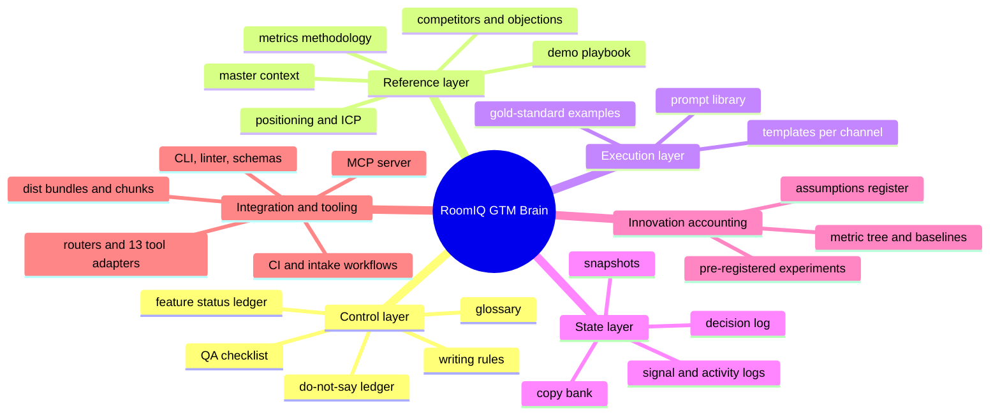

Three ideas carry the whole design:

1. **A small, always-loaded control layer** (about 6,200 tokens) governs every output. Depth lives in files loaded on demand.
2. **Typed truth.** Every statement carries an authority label (FACT, WORKING, OPEN) and every capability a status (SHIPPED, PARTIAL, UNVERIFIED, IN BUILD, ROADMAP). Agents reason from the type, not from tone.
3. **Append-only learning.** Activities and signals are logged before judgment, triaged on a clock, and only reach the ledgers through a dated decision. The brain gets sharper with use instead of going stale.

---

## 3. What RoomIQ is, as the brain encodes it

RoomIQ is room-level market intelligence and underwriting for the US rent-by-the-room (coliving) market. It tracks weekly room rents, room occupancy, fill events, listing status, and photos, and turns them into market scores, property signals, and revenue forecasts that show their evidence. Full detail: [`reference/product-surface.md`](reference/product-surface.md).

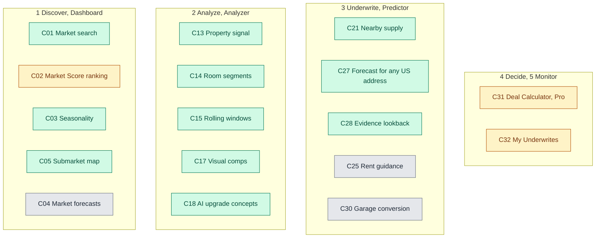

The stages run left to right: discover a market, analyze comparable properties, underwrite a target, model financed returns, save and re-run. The Dashboard's property drawer hands off straight to the Predictor ("Forecast Stabilized Revenue"). Green is SHIPPED (seen working), amber PARTIAL (partly seen), grey UNVERIFIED (control seen, output never captured). The diagram shows a subset; all 32 live in [`rules/feature-status.md`](rules/feature-status.md).

What makes RoomIQ unusual, and what the brain therefore protects: the product is candid about uncertainty. It prints the forecast formula, labels "Fallback support" and "Confidence Low", discloses median comp distance, and watermarks AI images. The brain turns that candor into positioning ("every number shows its evidence") and refuses to let copy outrun it (no accuracy claims until a backtest exists).

---

## 4. Architecture

### 4.1 Layers and precedence

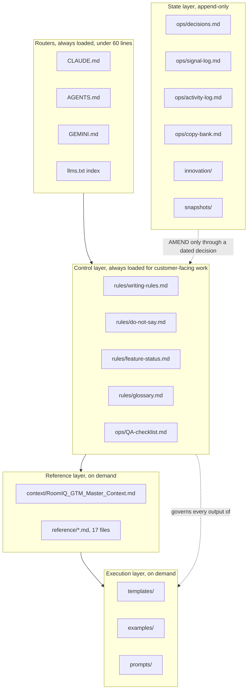

| When two sources disagree | Winner | Why |
|---|---|---|
| Product UI vs glossary draft | Product UI | The glossary mirrors the product; a mismatch is a glossary bug |
| `rules/` vs master context | Master context is authoritative, but changes land in `rules/` first | Rules are what gets loaded; the audit flags any rules file older than the master |
| `CLAUDE.md` vs `AGENTS.md` | `CLAUDE.md` | Stated in both routers |
| A WORKING decision vs an agent's instinct | The WORKING decision | It is the default until its trigger fires |
| Anything vs a hard ban in `rules/do-not-say.md` | The ban | Bans carry a replacement, so obeying never blocks the work |
| A source extract vs the master context | The source, followed by an AMEND | Sources are evidence; the master is a distillation |

### 4.2 The agent session contract

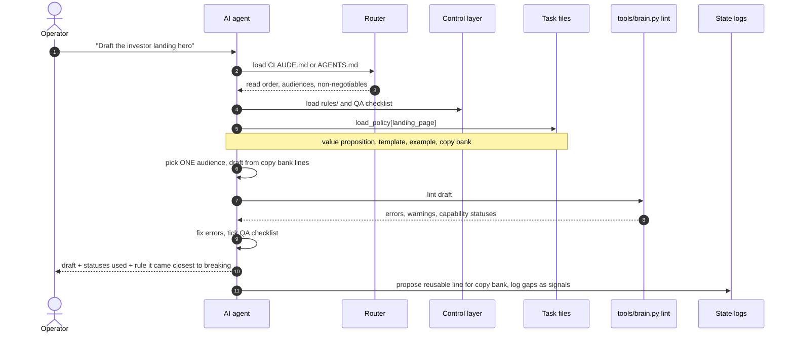

The load policy is code, not prose: `LOAD_POLICY` in [`tools/brain_lib.py`](tools/brain_lib.py) maps 16 task types to files, and both the CLI (`brain.py load <task>`) and the MCP server (`brain_load_for_task`) serve it.

### 4.3 Data model

The Markdown files are typed records. Parsers in `tools/brain_lib.py` read them; JSON Schemas in `schemas/` define them; CI validates them and every cross-reference between them.

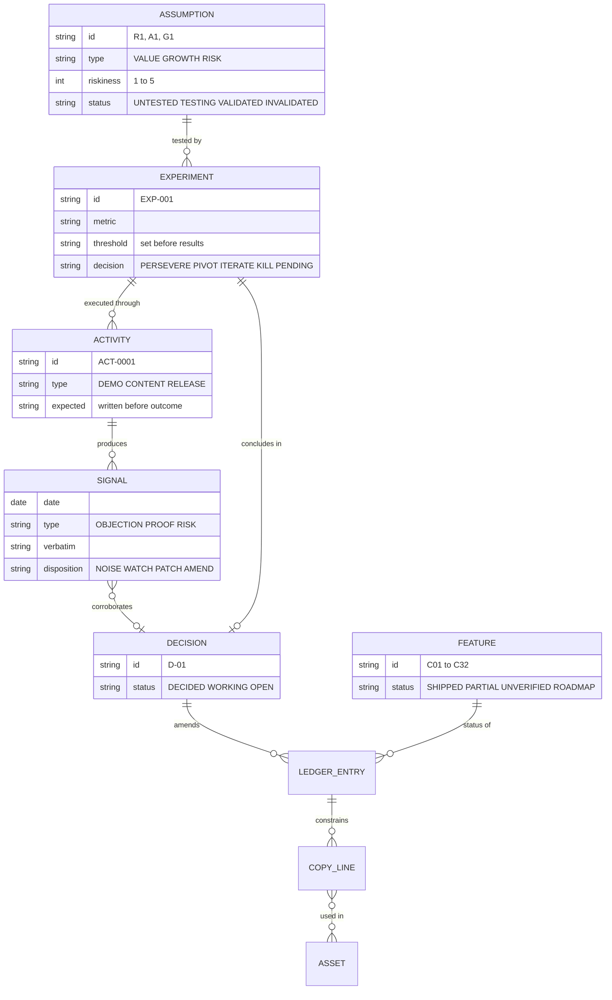

---

## 5. Use case A: the brain as the source of truth

### 5.1 What "source of truth" means here, mechanically

A GTM source of truth fails in one of three ways: it goes stale, it gets contradicted by a newer document nobody reconciled, or it states guesses with the same confidence as facts. The brain closes each failure with a mechanism, not a policy:

| Failure | Mechanism |
|---|---|
| Staleness | Every ledger carries `last_reviewed`; the audit fails on staleness thresholds; the master context frontmatter carries `version`, `last_updated`, and a one-line `status_notes` field an agent reads first |
| Silent contradiction | Single write path: ledger, then master context, then decision log, then copy, then the portable layer, then `build`. The PR template enforces the order; CI fails if generated files or adapters drift |
| Guesses stated as facts | Typed authority (FACT, WORKING, OPEN) and evidence-graded status (UNVERIFIED exists precisely so a button seen in a screenshot is never described as a working feature) |
| Invented proof | A closed proof set in `ops/copy-bank.md`. Today it holds zero customer proof, and the brain says so; agents write `[PROOF POINT NEEDED]` |
| Relitigating | Dated decisions with rationale and an explicit "what this does not change" line |

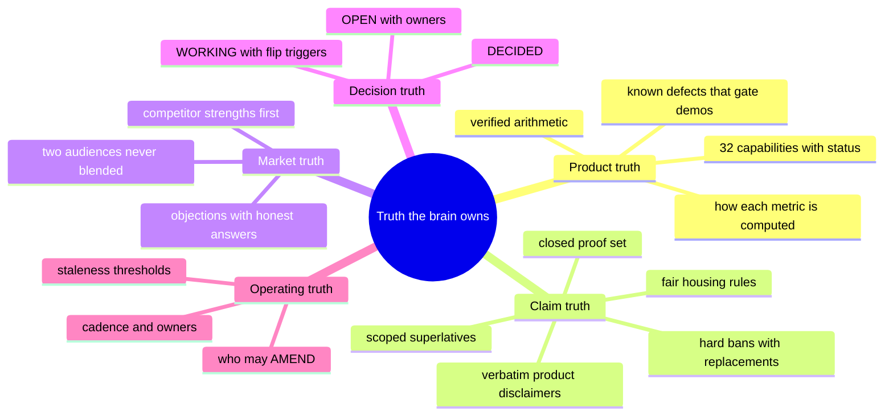

### 5.2 Which file answers this question

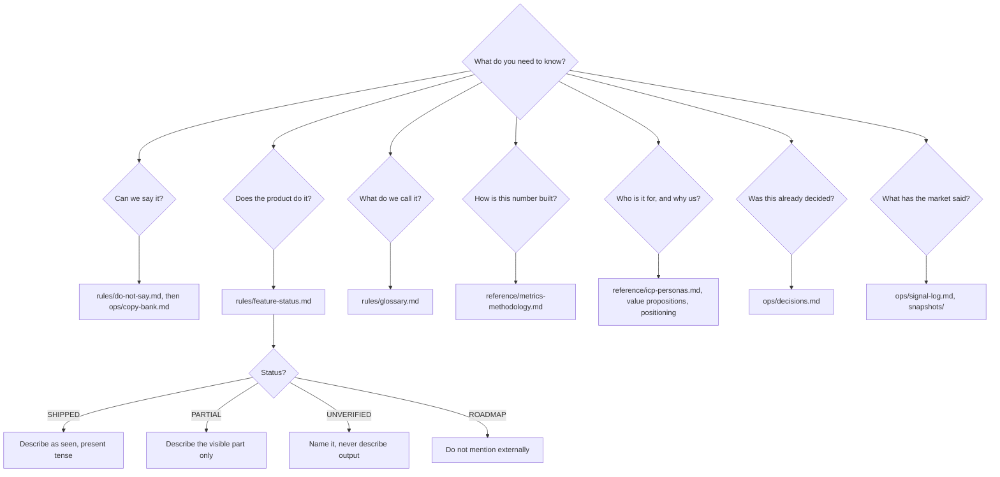

### 5.3 How a capability's status moves

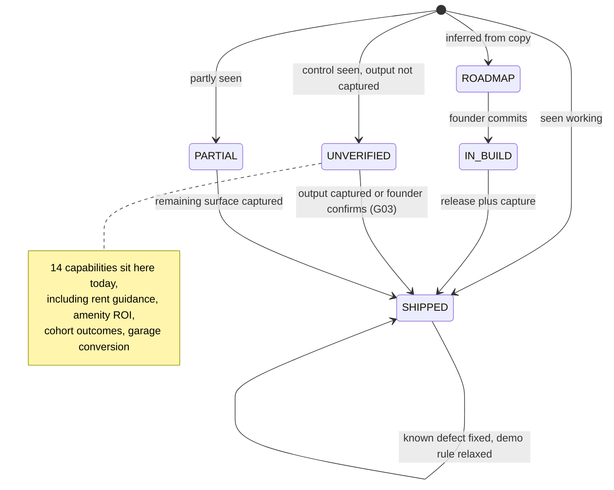

### 5.4 RoomIQ scenarios this use case covers

| Scenario | Who | What the brain does | Files |
|---|---|---|---|
| The pitch deck says "our forecasts are accurate" | Founder | Blocks the claim, offers "every forecast shows its formula, its comps, and a confidence label", points at EXP-002 (backtest) as the path to a scoped accuracy claim | `rules/do-not-say.md`, `innovation/experiments.md` |
| A prospect asks "where does your data come from?" on a call | Founder or sales | Gives the approved answer without naming a source, and logs the question as an OBJECTION signal | `reference/objection-handling.md`, `ops/signal-log.md` |
| An engineer writes release notes for garage conversion | Engineer | Stops: C30 is UNVERIFIED. Capture the output, AMEND the ledger to SHIPPED, then write the note from the template | `rules/feature-status.md`, `templates/release-note.md` |
| An agency builds the landing page | Contractor | Gets audience-specific pillars, the copy bank, a gold-standard hero, and a QA gate; no prices, no coverage numbers | `reference/value-proposition-investors.md`, `examples/` |
| A lender asks how revenue is estimated | Investor, lender | Answers from verified methodology rows only; never "lender-ready" | `reference/metrics-methodology.md` |
| Someone drafts a pricing page | Anyone | Refuses: D-11 is OPEN. Records the packaging hypotheses instead | `ops/decisions.md`, `reference/pricing-packaging.md` |
| A demo is booked in a new city | Founder | Checks the covered-metro list and the landmine table before the call | `reference/demo-playbook.md` |
| A new hire, VA, or support rep starts | Anyone | Reads Section 15 of the master context: the twenty facts looked up most | `context/RoomIQ_GTM_Master_Context.md` |

### 5.5 The amendment path, the only way truth changes

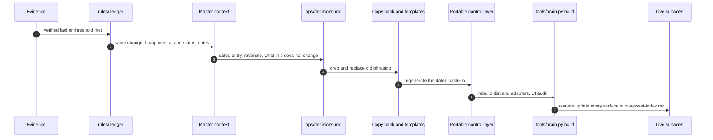

---

## 6. Use case B: the brain as the context layer for every AI tool

### 6.1 Context engineering, not prompt stuffing

The constraint every AI tool shares is the context window. The brain is designed around it:

- **Always-loaded is small.** The control layer is about 6,200 tokens (router 865, writing rules 883, do-not-say 1,332, feature status 1,232, glossary 1,093, QA checklist 760). The portable version for chat models is about 1,400 tokens.
- **Everything else is loaded per task.** A demo task loads about 8,900 tokens in total; a landing page about 10,900; a strategy question about 16,600 including the master context.
- **The control layer is injected, never retrieved.** A retrieval miss on the claim ledger is the precise failure the brain exists to prevent. RAG is for reference and execution files only.
- **Guardrails go last** in long bundles, because models weight the end of a prompt more heavily.

| Artifact | Size | Use |
|---|---|---|
| `adapters/portable-control-layer.md` | about 5,700 characters | Instruction boxes: custom GPTs, Gemini Gems, Grok |
| `dist/roomiq-gtm-brain.bundle.md` | about 16,000 tokens | Claude.ai or ChatGPT Projects, system prompts |
| `dist/llms-full.txt` | about 67,000 tokens | Long-context models, notebook tools |
| `dist/brain.chunks.jsonl` | about 350 heading-level chunks with metadata | Vector stores, your own RAG |
| `dist/ledgers.json` | every ledger as JSON | Product code, CI gates, dashboards |
| `dist/skill/gtm-brain.bundle.md` | about 17,000 tokens | Running the build method itself in a chat model |

### 6.2 Integration architecture

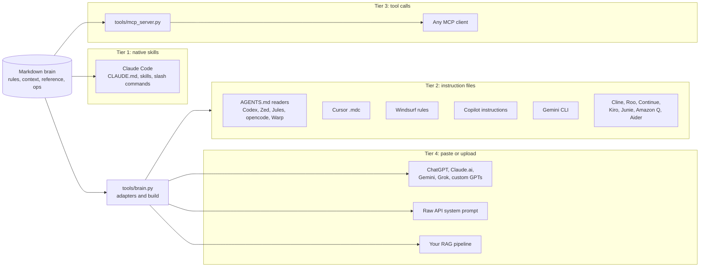

Every tier-2 pointer is rendered from one template ([`tools/templates/pointer-body.md.tmpl`](tools/templates/pointer-body.md.tmpl)), carries no strategy of its own, and is checked for drift in CI. Full matrix and the seven-prompt conformance check: [`adapters/README.md`](adapters/README.md).

| Tool | Loads from | Mechanism |
|---|---|---|
| Claude Code | `CLAUDE.md`, `.claude/skills/`, `.claude/commands/`, `.mcp.json` | Native |
| Codex CLI, IDE, cloud | `AGENTS.md` | Always in context |
| Cursor | `.cursor/rules/roomiq-gtm.mdc`, `.cursor/mcp.json` | Rule plus MCP |
| Windsurf | `.windsurf/rules/roomiq-gtm.md` | `always_on` rule |
| GitHub Copilot | `.github/copilot-instructions.md`, `.vscode/mcp.json` | Instructions plus MCP |
| Gemini CLI | `GEMINI.md`, `.gemini/settings.json` | Context file plus MCP |
| Cline, Roo, Continue, Kiro, Junie, Amazon Q | Their rules folders | Workspace rules |
| Aider | `.aider.conf.yml` | `read:` list |
| Any MCP client | `tools/mcp_server.py` | Tools, resources, prompts |

### 6.3 An MCP session, end to end

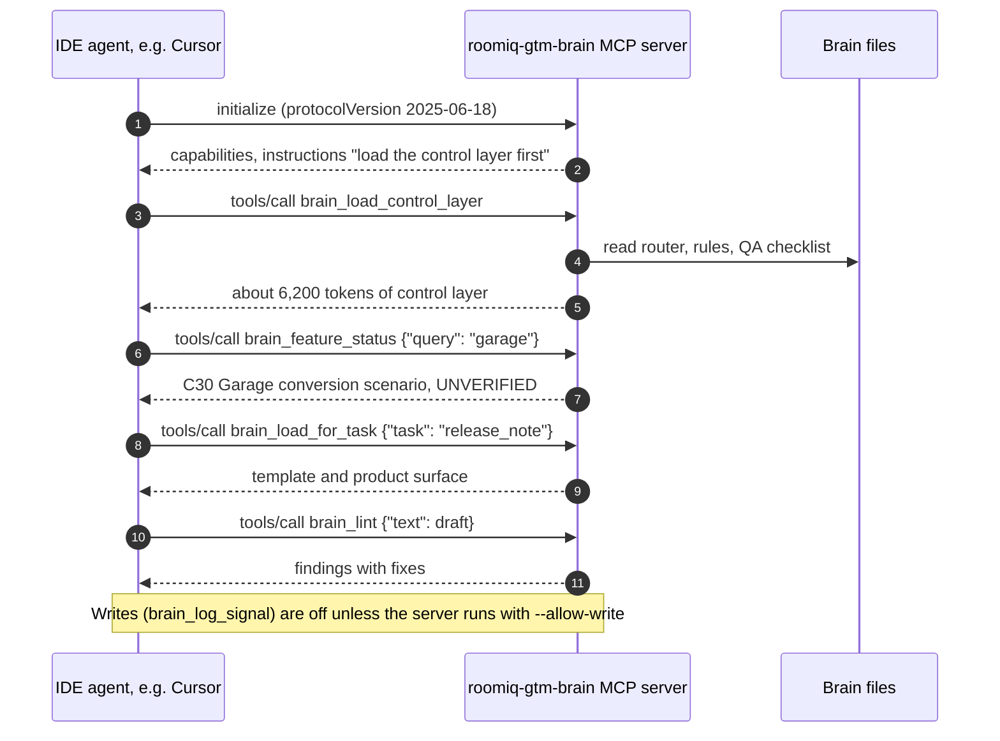

### 6.4 Wiring the RoomIQ product codebase (the highest-value door)

Most customer-facing words at a technical company are written in the product repo: UI strings, empty states, error messages, onboarding emails, release notes, the pricing page, and the prompts behind any LLM feature. That is exactly where Copilot, Cursor, and Codex operate, so the brain goes there as a submodule:

```bash
cd roomiq-app
git submodule add https://github.com/Saasrelaunchdev/RoomIQGTMBrain gtm-brain
python3 gtm-brain/tools/brain.py adapters --install . --brain-path gtm-brain
```

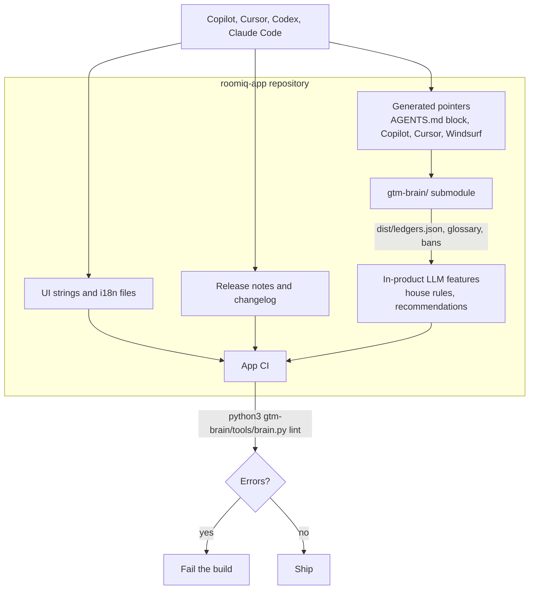

Predicted uses in the product repo:

- **UI copy that matches its own numbers.** The discovery found a results banner that contradicts the formula beneath it (D-Q26) and copy that mixes "baseline" and "forecast" (Q33). An agent writing strings with the glossary loaded uses one term and checks banners against the math. Proposed fixes are already in [`examples/in-app-copy-fixes.md`](examples/in-app-copy-fixes.md).
- **Release notes that follow the ledger.** The release-note template refuses to draft until `rules/feature-status.md` is updated, so a changelog never announces an UNVERIFIED capability.
- **Runtime guardrails for LLM output.** If house-rule or amenity recommendations are LLM-generated (open question G19), the generated text can be linted at test time against the same bans, including the fair-housing list. A minimal test:

```python
# tests/test_generated_copy.py in the product repo
import sys; sys.path.insert(0, "gtm-brain/tools")
import brain_lib

def test_house_rules_output_is_clean(generated_house_rules):  # your fixture
    result = brain_lib.lint(generated_house_rules)
    assert result["errors"] == 0, result["findings"]
```

- **Typed access from TypeScript or any language.** `dist/ledgers.json` is a stable contract: gate a feature flag on `features[].status === "SHIPPED"`, render glossary tooltips, or block a marketing banner that names a ROADMAP item.

### 6.5 More context-layer uses, predicted for RoomIQ

| Use | Tool | Brain files it runs on |
|---|---|---|
| Sales call copilot: battlecards and objections on demand during a call | Claude Desktop or ChatGPT with the bundle | `reference/competitor-battlecards.md`, `reference/objection-handling.md` |
| Help center and support assistant answering "what is Evidence Quality?" | Any LLM with RAG over `dist/brain.chunks.jsonl` plus the injected control layer | `reference/metrics-methodology.md`, `rules/glossary.md` |
| Content pipeline: plan, draft, lint, open a PR | Claude Code or Codex in CI | `reference/content-engine.md`, `templates/seo-article.md` |
| Investor or advisor update drafts | Any agent | `innovation/metrics.md`, `ops/decisions.md`, closed proof set |
| Demo prep for a specific prospect | Claude Code `/demo` | `reference/demo-playbook.md`, `templates/demo-script.md` |
| Agency or freelancer onboarding with zero repo access | Custom GPT with the portable layer | `adapters/portable-control-layer.md` |

---

## 7. Use case C: the brain as the innovation accounting layer

### 7.1 Why innovation accounting, and why here

Innovation accounting (from Lean Startup practice) replaces "are we busy?" with "are we learning, and is the learning moving a decision?" It has three steps: **establish a baseline**, **tune the engine** with experiments whose success thresholds are set in advance, and **pivot or persevere** on a fixed cadence.

RoomIQ is the textbook case: a shipped, sophisticated product with no customer proof, no measured funnel, and a handful of assumptions that could each end the current go-to-market (data rights, coverage depth, willingness to pay). The brain is the natural home for the accounting because it already holds the ledgers the learning must eventually change. The protocol: [`reference/innovation-accounting.md`](reference/innovation-accounting.md).

| Step | File | State today |
|---|---|---|
| Baseline | [`innovation/metrics.md`](innovation/metrics.md) | North Star and 10 input metrics defined; every baseline "not measured" (the honest finding of [`snapshots/2026-11-13-baseline.md`](snapshots/2026-11-13-baseline.md)) |
| Assumptions | [`innovation/assumptions.md`](innovation/assumptions.md) | 13 leap-of-faith assumptions, riskiest first: R1 data rights, R2 coverage, A1 investors run real deals |
| Experiments | [`innovation/experiments.md`](innovation/experiments.md) | 6 pre-registered, thresholds written before any result |
| Decisions | [`ops/decisions.md`](ops/decisions.md) | PERSEVERE, PIVOT, ITERATE, or KILL, dated, with evidence |

### 7.2 The snowball: how every activity compounds

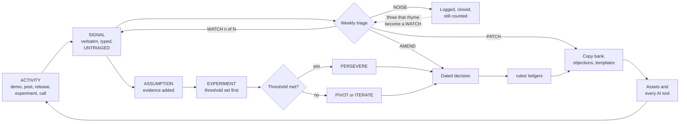

Why this compounds rather than accumulates:

- **Language accumulates.** Buyer phrasing promoted from the signal log into the copy bank outperforms internal phrasing, and it is never lost because the verbatim is mandatory.
- **Objections become pre-vetted answers.** The tenth time "where does the data come from?" is heard, the answer is tested, written down, and in every agent's context.
- **Risk falls monotonically.** Every challenged claim tightens the claim ledger, and the counter-example stays in the file, so the broad claim cannot creep back.
- **Decisions stop being relitigated.** A dated verdict with its evidence is argued once.
- **Each AMEND improves every future output, from every tool, with nobody re-briefed.** That is what compounding means here: the floor rises for all work at once.

### 7.3 Everything the brain can receive

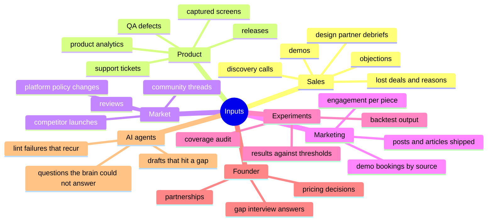

### 7.4 Signal disposition, as a state machine

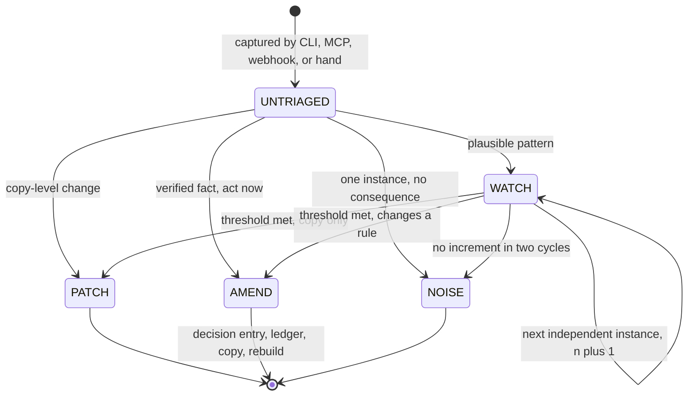

Thresholds: opinions need 3 independent instances in 60 days; verifiable facts (status, proof, competitive, risk) need 1 verified instance; loss reasons need 2, or 1 from a design partner; channel performance needs a full measurement cycle.

### 7.5 The metric tree

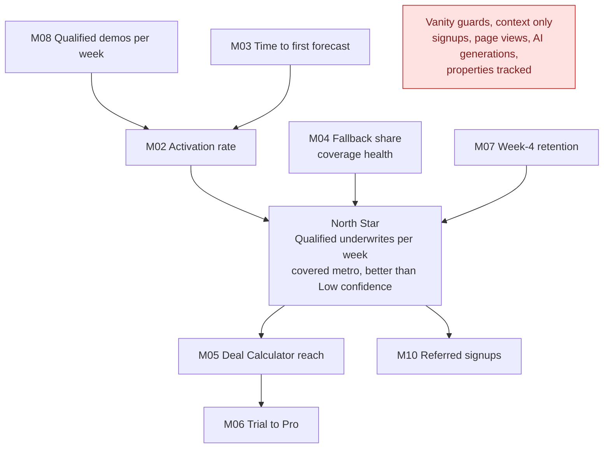

### 7.6 Automated intake from anywhere

The founder is technical, so intake should not depend on someone remembering to edit Markdown. Three paths write the same append-only entries, all validated against `schemas/`:

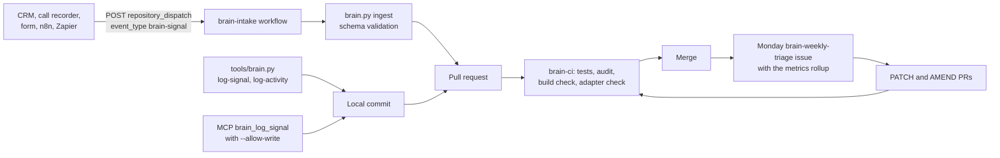

```bash
curl -X POST https://api.github.com/repos/Saasrelaunchdev/RoomIQGTMBrain/dispatches \
  -H "Authorization: Bearer $GITHUB_TOKEN" -H "Accept: application/vnd.github+json" \
  -d '{"event_type":"brain-signal","client_payload":{"type":"OBJECTION","source":"demo call",
       "verbatim":"Where does your data come from?","context":"Investor, Dallas, stage 4"}}'
```

Payload values travel through environment variables in the workflow, never through shell interpolation, so a hostile payload cannot run commands.

### 7.7 Predicted RoomIQ learning loops

| Trigger | Signal and disposition | What changes | What does not |
|---|---|---|---|
| Three design partners ask where the data comes from within 60 days | OBJECTION, WATCH 1/3 to 3/3, then AMEND | Objection answer revised; a methodology page becomes an experiment; R1 stays riskiest | No source is named until G11 is answered |
| EXP-005 shows a preset metro below 60 percent better-than-Low forecasts | RISK, 1 verified instance, AMEND | That metro leaves the demo list (D-06) and early targeting; M04 baseline recorded | Copy elsewhere is untouched |
| A release fixes the D-Q26 banner | STATUS, AMEND | Known-defects list shrinks; the demo playbook drops a landmine; a release note ships | Accuracy ban stays |
| A partner says "I would pay for this if the calculator had expenses" | LANGUAGE plus evidence on A3 | Verbatim banked if corroborated; expense model logged as a product signal | Pricing stays OPEN |
| A competitor launches room-level investor analytics | COMPETITIVE, act immediately | Battlecard added; every superlative re-run through the counter-example drill | Positioning holds unless the wedge is gone |
| The garage-conversion article books the most demos for a full cycle | CHANNEL, after the cycle | Campaign 2 reordered; C30 verification prioritized | Paid stays out (D-10) |
| EXP-002 backtest completes with a stated error by confidence label | PROOF, AMEND | D-05 amended; a scoped accuracy line enters the copy bank; lenders become a candidate audience | Transparency stays the lead message |

### 7.8 Learning velocity, measured

`python3 tools/brain.py metrics` reports the health of the loop itself. Current output (day zero):

```text
## Learning velocity
- Signals: 9 total, 9 in 7 days, 9 in 30 days, 0 untriaged
- Activities: 5 total, 5 in 7 days, 2 with outcome pending
- Experiments: {'PLANNED': 5, 'BLOCKED': 1}  decisions {'PENDING': 6}
- Assumptions: {'UNTESTED': 13}; riskiest untested: R1, R2, A1, R3, A3
- Decisions: {'DECIDED': 7, 'OPEN': 1, 'WORKING': 4}, 12 dated in the last 30 days
- Open WATCH items: 0
```

Healthy looks like: at least 5 signals a week during the design-partner program, no WATCH older than two triage cycles, at least one AMEND and one finished experiment a month, the riskiest assumptions resolved first, and a snapshot every 31 days.

---

## 8. Operating cadence

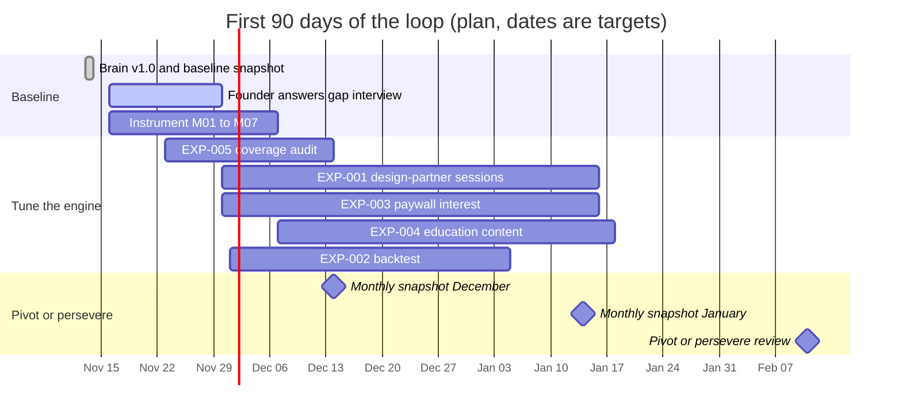

| Ritual | When | Output |
|---|---|---|
| Signal and activity triage | Weekly, Monday (issue opened by CI) | Dispositions, WATCH counters, PATCH PRs, AMEND proposals |
| Ledger sweep | Monthly | `last_reviewed` updated on every `rules/` file |
| Snapshot | Monthly | `snapshots/YYYY-MM-DD-label.md`, ending in what it changed |
| Pivot or persevere | Every 90 days or at a learning milestone | A dated decision either way |
| Brain audit | Every push (CI) and quarterly by hand | Audit plus one live asset produced only from the brain |

---

## 9. Getting started by role

**Founder.** Answer [`ops/founder-gap-interview.md`](ops/founder-gap-interview.md); 21 questions, each with the default the brain runs on, so most answers are "confirmed". Then read Section 0 and Section 15 of the master context. Then run `python3 tools/brain.py metrics` every Monday.

**Engineer.** Add the brain to the product repo as a submodule and run `adapters --install` (Section 6.4). Wire `brain_lib.lint` into tests for any generated user-facing text. Update `rules/feature-status.md` in the same PR as any release.

**Marketer, agency, or freelancer.** Start from `templates/` and `examples/`, use `ops/copy-bank.md` verbatim, run `python3 tools/brain.py lint`, then `ops/QA-checklist.md`. No repo access? Use `adapters/portable-control-layer.md` in a custom GPT.

**Sales or support.** `reference/objection-handling.md`, `reference/competitor-battlecards.md`, `reference/demo-playbook.md`. Log every objection verbatim.

**An AI agent.** Read `CLAUDE.md` or `AGENTS.md`. Load the control layer. Pick one audience. Load the task files. Draft, lint, QA, and name the rule you came closest to breaking.

---

## 10. CLI and MCP reference

| Command | Does |
|---|---|
| `brain.py audit [--quiet]` | Runs the skill's `audit_brain.py` (structure, links, index, size budgets, banned words, em dashes, placeholders, staleness) plus structural checks (ledger parsing, cross-references, schema validation, generated-file and adapter freshness, portable-layer date) |
| `brain.py validate` | Structural checks only |
| `brain.py lint FILE... [--json] [--strict] [-v]` | Mechanical QA: em dashes, banned words, do-not-say phrases, fair-housing phrases, capability status by alias, superlatives, price patterns, the fallback clause |
| `brain.py status [QUERY] [--json]` | Feature ledger by ID, name, alias, or status |
| `brain.py search QUERY [-k N] [--sources]` | BM25 over heading-level sections, authority-boosted |
| `brain.py load TASK [--paths]` | Control layer plus the task's files, per the load policy |
| `brain.py glossary [TERM]` | Canonical vocabulary |
| `brain.py log-signal`, `log-activity`, `new-experiment` | Append-only writers with required verbatim, expected outcome, or threshold |
| `brain.py ingest --event E --payload-env VAR` | Append from JSON (webhooks, CI) after schema validation |
| `brain.py metrics [--json]` | Innovation accounting rollup |
| `brain.py build [--check]` | Regenerate or verify `dist/` |
| `brain.py adapters [--check, --write, --install REPO --brain-path P]` | Render, verify, or install tool adapters |

MCP tools: `brain_load_control_layer`, `brain_load_for_task`, `brain_search`, `brain_read`, `brain_feature_status`, `brain_glossary`, `brain_decisions`, `brain_lint`, `brain_metrics`, and opt-in `brain_log_signal`, `brain_log_activity`. Resources: every file as `brain:///<path>`. Prompts: every job in `prompts/common-tasks.md`. Details and client configs: [`adapters/mcp/README.md`](adapters/mcp/README.md).

---

## 11. Governance and CI

| Change type | Who | Gate |
|---|---|---|
| Intake (signal, activity) | Anyone, any tool, any webhook | Schema validation, PR |
| PATCH (copy, objections, templates) | Anyone producing work, including agents | PR, CI |
| AMEND (anything in `rules/`, positioning, ICP, channels, pricing) | Founder approval | PR template checklist in the amendment order, CI |
| Generated files (`dist/`, adapters) | Never by hand | `build --check`, `adapters --check` |

CI ([`.github/workflows/brain-ci.yml`](.github/workflows/brain-ci.yml)) runs on every push and PR: unit tests, the audit, the generated-file check, the adapter check, lint on the gold-standard examples, and the metrics summary. [`brain-intake.yml`](.github/workflows/brain-intake.yml) turns webhooks into PRs. [`brain-weekly-triage.yml`](.github/workflows/brain-weekly-triage.yml) opens the Monday triage issue.

---

## 12. Honest status of this build

What is solid:
- Every capability statement traces to a screen. Arithmetic shown in the product was reproduced and recorded (`reference/metrics-methodology.md`).
- The control layer is complete and checked by machine on every push.
- Every adapter loads the same rules, generated from one template.

What is a working hypothesis, and labeled as one:
- The audience order (D-07), category (D-08), lead message (D-09), and channel mix (D-10). Each names the trigger that flips it.
- Competitive facts come from a public desk scan dated 2026-11-13 and must be re-verified before external use.

What is unknown, and blocks claims until answered:
- Data source and rights (G11, G12), coverage (G13), backtest (G14), pricing (G07), the outputs of 14 UNVERIFIED capabilities (G03), and fixes for D-Q26, D-Q28, D-Q30, D-Q31 (G15 to G17).
- All gold-standard examples and copy-bank lines are checked against the ledgers but await founder approval.

The fastest way to move the brain from v1.0 to v1.1: answer the gap interview, capture the P1 screens in the coverage-gap list, and run EXP-005 before any demo push.

---

## 13. FAQ for engineers

**Why Markdown and not a database?** Every agent can read Markdown with zero integration, diffs are reviewable, git is the audit log, and the typed structure is enforced by parsers and schemas in CI. `dist/ledgers.json` gives you the database view when you need one.

**Why are rules duplicated in the master context?** The master context is the reference brain, loaded when strategy is in question. The `rules/` files are the enforcement layer, loaded on every task, which only works because they are short. The audit flags the two drifting apart.

**Why not RAG everything?** Retrieval is probabilistic; guardrails cannot be. The control layer is injected whole; retrieval is for reference and execution files.

**Why is there an UNVERIFIED status?** The only evidence today is screenshots. A visible button whose output was never captured cannot be described without inventing its output, and invented capability descriptions are the most common way AI-written copy overclaims.

**Can a tool change the rules?** No. Tools only append to the two logs. Ledger changes go through a reviewed PR in a fixed order.

**How do I add a tool?** Add an entry to `render_adapters` in `tools/brain_lib.py`, run `python3 tools/brain.py adapters --write`, and run the conformance prompts in `adapters/README.md` in that tool.

**How do I add a capability?** Add a line to `rules/feature-status.md` in the parseable format with aliases, update the master context, add a decision entry, run `build`. The linter picks up the aliases immediately.

**Does this scale past one founder?** The structure is the same at ten people: owners per ledger in `ops/review-cadence.md`, AMEND authority in the PR template, CI as the gate.

---

## 14. Repository layout

```text
RoomIQGTMBrain/
  CLAUDE.md  AGENTS.md  GEMINI.md  llms.txt  README.md     routers and index
  context/RoomIQ_GTM_Master_Context.md                       the distilled source of truth
  rules/            writing-rules, do-not-say, feature-status, glossary
  reference/        17 on-demand files: product surface, feature matrix, ICP, positioning,
                    value propositions x2, journey, competitors, battlecards, objections,
                    campaigns, content engine, demo playbook, trust and risk, pricing,
                    metrics methodology, innovation accounting
  innovation/       assumptions, experiments, metrics
  ops/              decisions, signal-log, activity-log, copy-bank, asset-index,
                    QA-checklist, review-cadence, founder-gap-interview
  snapshots/        dated state captures, starting with the baseline
  templates/        one per channel in the working mix
  examples/         gold-standard drafts, each with "why this works"
  prompts/          filled prompts per recurring job
  pages/            shipped long-form assets (none yet)
  adapters/         adapter guide, portable control layer, MCP guide, consuming-repo copies
  tools/            brain_lib.py, brain.py, mcp_server.py, templates/, tests/
  schemas/          JSON Schema for signal, activity, experiment, assumption, decision, feature
  dist/             generated: bundle, llms-full, manifest, chunks, ledgers, skill bundle
  sources/          source manifest and the discovery extracts
  .claude/          the go-to-market-brain and gtm-slop-filter skills, slash commands
  .github/          CI, intake, weekly triage, Copilot instructions, PR template
  .cursor/ .windsurf/ .clinerules/ .roo/ .continue/ .kiro/ .junie/ .amazonq/
  .vscode/ .gemini/ .mcp.json .aider.conf.yml                 generated tool doors
```

Every file is listed with its purpose in [`llms.txt`](llms.txt) and, machine-readably, in [`dist/brain.manifest.json`](dist/brain.manifest.json).

---

## 15. Provenance and license

- **Method:** the go-to-market-brain and gtm-slop-filter skills by alielshenawy1, MIT License, installed with the project's `install.sh` (`--codex`, then `--all --bundle`) from commit `305e6f7`. Skill files live unmodified in `.claude/skills/`.
- **Sources:** the RoomIQ discovery pack in `Saasrelaunchdev/roomIQGTMBuild` (commit `9ed7a8b`), copied as text into `sources/extracted/discovery/`. Screenshots stay in that repository because they show third-party listing photos, host names, and account details (`sources/README.md`).
- **Competitive facts:** public pages scanned on 2026-11-13; re-verify before external use.
